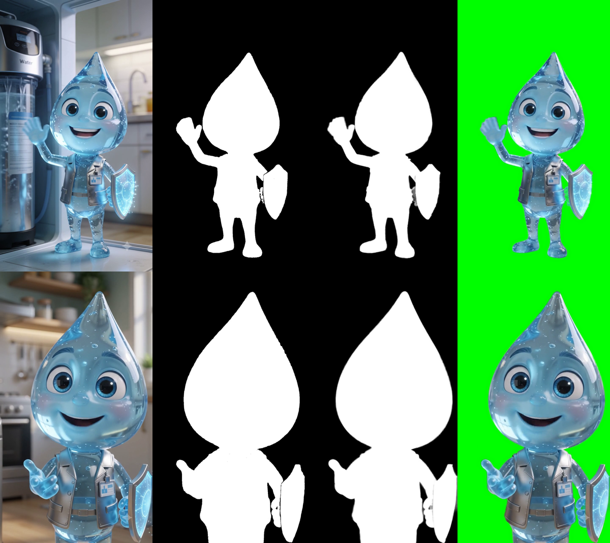

<div align="center">

# 🪄 MAGIC ROTO

### Free AI rotoscoping for video, built in ComfyUI

**Type what you want to cut out → get a clean, soft-edged alpha matte for every frame.**

SAM3 finds and tracks the object · VitMatte refines the edges · a temporal pass calms the flicker

`100% free` · `runs locally` · `open-source models` · `works on an 8 GB laptop GPU`


</div>

---

## What it does

Rotoscoping means cutting a subject out of video frame by frame, and it is one of the most tedious jobs in video editing.
MAGIC ROTO does it automatically:

1. You type a word, such as `person`, `dog`, `car` or `water drop character, shield`.
2. **SAM3** (Meta's Segment Anything 3) finds that object and **tracks it through the whole clip**, including across scene cuts.
3. **VitMatte** turns SAM3's blocky mask into a **soft, detailed edge**, so hair, glow and semi-transparent parts blend naturally.
4. A **temporal smoothing** pass reduces the frame-to-frame edge flicker that per-frame AI matting produces.
5. You get a **PNG alpha sequence** to drop into DaVinci Resolve, Premiere, After Effects or Nuke, plus preview videos.


<sub>Left to right: original frame · raw SAM3 mask · refined MAGIC ROTO matte · cut-out on green. Top row is before a scene cut, bottom row is after it; the track holds through the cut.</sub>

---

## Why two AI models?

Cutting something out of video is really **two different problems**:

| Problem | Question | Model | Strength | Weakness |
|---|---|---|---|---|
| **Segmentation** | *Which pixels are the object?* (yes or no) | **SAM3** | Finds and tracks objects from a text prompt | Blocky, hard edges |
| **Matting** | *How much of this edge pixel is the object?* (0–100%) | **VitMatte** | Hair-level soft edges | Can't find objects by itself |

MAGIC ROTO chains them: **SAM3 makes the rough cut and VitMatte cleans the edges.** The link between them is a **trimap**. See [How it works](docs/how-it-works.md).

---

## Pipeline

```
 Video ─► SAM3 detect + track ─► hard mask ─► Trimap ─► VitMatte ─► Temporal smooth ─► Alpha PNGs
            (text prompt)                    (erode/dilate)  (edge band only)                    │
                                                                                                 ├─► matte preview .mp4
                                                                                                 └─► cut-out on green .mp4
```

---

## Requirements

| | Minimum | Tested on |
|---|---|---|
| ComfyUI | A version with the **core SAM3 nodes** (`SAM3 Detect`, `Run SAM3 Video Track`) | ComfyUI **0.38.2** |
| GPU | NVIDIA, ~6 GB VRAM | RTX 5060 Laptop, **8 GB** |
| RAM | 16 GB (keep clips short) | 16 GB |
| Python packages | `transformers`, `opencv-python`, `huggingface_hub` | transformers 5.8, PyTorch 2.10 + CUDA 13 |
| Disk | ~2 GB for models | |

> VitMatte itself is light: about **0.6 GB VRAM** for a 1280-pixel frame in fp16.

---

## Installation

### 1. Update ComfyUI
MAGIC ROTO uses ComfyUI's **built-in SAM3 nodes**. Update ComfyUI if you can't find `Run SAM3 Video Track` in the node search.

### 2. Install the custom nodes
Copy the folder `custom_nodes/comfyui-magic-roto` into your `ComfyUI/custom_nodes/` folder:

```bash
git clone https://github.com/suryateja963/MAGIC-ROTO.git
```

```bash
cp -r MAGIC-ROTO/custom_nodes/comfyui-magic-roto /path/to/ComfyUI/custom_nodes/
```

Then install its Python requirements **using ComfyUI's own Python** (for example the one in `ComfyUI/.venv`):

```bash
/path/to/ComfyUI/.venv/Scripts/python -m pip install -r MAGIC-ROTO/custom_nodes/comfyui-magic-roto/requirements.txt
```

<sub>Most ComfyUI installs already have all three packages.</sub>

### 3. Download the models
```bash
/path/to/ComfyUI/.venv/Scripts/python MAGIC-ROTO/scripts/download_models.py /path/to/ComfyUI
```

This fetches both models from their official Hugging Face pages:

| Model | Size | Saved to |
|---|---|---|
| [`Comfy-Org/sam3.1`](https://huggingface.co/Comfy-Org/sam3.1): `sam3.1_multiplex_fp16.safetensors` | ~1.7 GB | `ComfyUI/models/checkpoints/` |
| [`hustvl/vitmatte-small-composition-1k`](https://huggingface.co/hustvl/vitmatte-small-composition-1k) | ~100 MB | `ComfyUI/models/vitmatte/vitmatte-small-composition-1k/` |

You can also download them by hand and put them in the folders above.

### 4. Restart ComfyUI
You should now see a **MAGIC ROTO** category with four nodes.

---

## Quick start

1. Put a short clip (**3–10 seconds**) in `ComfyUI/input/` and name it `magic_roto_input.mp4`, or pick your own file in the node.
2. Drag [`workflows/magic_roto_video_matte.json`](workflows/magic_roto_video_matte.json) onto the ComfyUI canvas.
3. In **"What to cut out"**, type your subject, e.g. `person`.
4. Click **Run**.
5. Find the results in `ComfyUI/output/magic_roto/`:

| File | What it is |
|---|---|
| `alpha_00001_.png …` | **The matte sequence**: white = subject, black = background. This is what you import into your editor. |
| `alpha_preview_*.mp4` | The matte as a video, for a quick check |
| `on_green_*.mp4` | The cut-out over green, to judge the edges |
| `sam_raw_*.mp4` | SAM3's raw mask before VitMatte, for comparison |

➡️ **Using the matte in DaVinci Resolve (free version):** [docs/davinci-resolve.md](docs/davinci-resolve.md)

---

## The nodes

| Node | What it does |
|---|---|
| **MAGIC ROTO: Mask to Trimap** | Turns a hard mask into a trimap: sure object / sure background / unknown edge band |
| **MAGIC ROTO: Refine Edges** | Runs VitMatte only inside the unknown band. Downscales big frames to fit VRAM and upscales the result back |
| **MAGIC ROTO: Temporal Smooth** | Blends each frame's edge with the previous one where nothing moved, to reduce "edge boiling" |
| **MAGIC ROTO: Preview on Colour** | Composites the footage over any solid colour using the matte, sized automatically |

Every setting is explained in **[docs/settings.md](docs/settings.md)**.

---

## Prompting tips

- **Be specific:** `person` finds all people. Raise `max_objects` in the SAM3 track node to keep more than one.
- **Several things:** separate them with commas: `water drop character, shield`.
- **Count per prompt:** `eye:2, window:4` keeps up to 2 eyes and 4 windows.
- **Prompt the subject, not the background.** For green screen, prompt the person and use the matte as is.
- **Something missing in later frames?** Name it explicitly. In testing, a held shield was dropped after a scene cut until it was added to the prompt.

---

## Performance (RTX 5060 Laptop, 8 GB)

| Clip | Frames | Result |
|---|---|---|
| 720×1280, 3 s @ 24 fps, with a scene cut | 72 | Full pipeline ran end to end in one go; the track held through the cut |

Rough guidance: keep clips **≤ 10 s** at 1080p on a 16 GB RAM machine, because every frame is held in memory. Split longer shots and run them in parts.

---

## Limitations

- **Not a click-inside-your-editor plugin.** You work in ComfyUI and import the matte, unlike commercial OFX roto plugins.
- **No per-frame manual correction yet.** If SAM3 picks the wrong thing, change the prompt or threshold and run again.
- **Edge stabilisation is basic.** It's a motion-gated blend, not optical-flow warped, so very fast motion can leave slight trails when `strength` is high.
- **Transparent and glowing objects** are matted as a solid shape plus a soft edge. True see-through transparency in the alpha isn't recovered.
- **Long clips** use a lot of RAM.

Ideas and fixes: see [docs/troubleshooting.md](docs/troubleshooting.md).

---

## Roadmap

- [ ] Point and box prompts in the example workflow, alongside text
- [ ] Optical-flow-warped temporal stabilisation
- [ ] Chunked processing for long clips
- [ ] Option for the larger `vitmatte-base` model
- [ ] EXR output

---

## Repository layout

```
MAGIC-ROTO/
├── custom_nodes/comfyui-magic-roto/   # the ComfyUI node pack
│   ├── __init__.py
│   └── requirements.txt
├── workflows/
│   └── magic_roto_video_matte.json    # ready-to-run workflow
├── scripts/
│   └── download_models.py             # fetches SAM3 + VitMatte
├── docs/
│   ├── how-it-works.md
│   ├── settings.md
│   ├── davinci-resolve.md
│   └── troubleshooting.md
└── assets/                            # README images
```

---

## Credits & licences

- **SAM3 / SAM 3.1**: Meta AI, via the [Comfy-Org/sam3.1](https://huggingface.co/Comfy-Org/sam3.1) repackaging and ComfyUI's core SAM3 nodes.
- **VitMatte**: [hustvl/ViTMatte](https://github.com/hustvl/ViTMatte), loaded with Hugging Face `transformers`.
- **ComfyUI**: [comfyanonymous/ComfyUI](https://github.com/comfyanonymous/ComfyUI).

The **code in this repo** is MIT-licensed (see [LICENSE](LICENSE)).
**Model weights are not included.** They are downloaded from their official pages and stay under their own licences, so check each model card before commercial use.

The demo clip is an AI-generated character made by the repo author.
